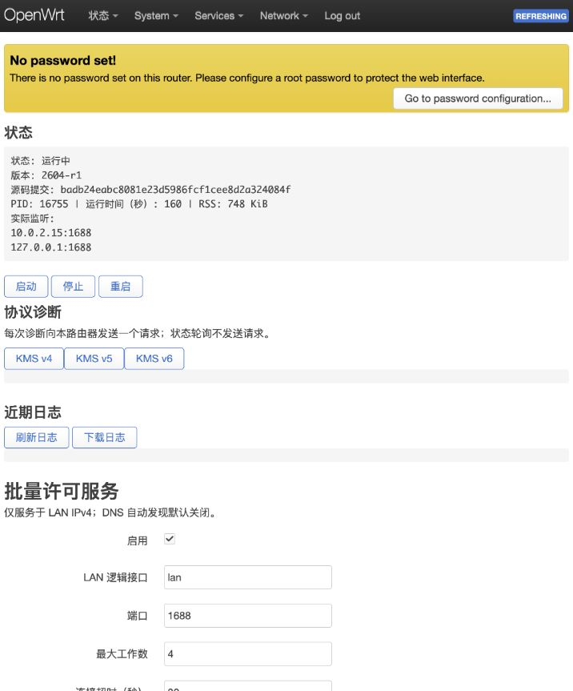

# 验证报告

验证日期：2026-10-21（Asia/Shanghai）。所有有写入的测试均在隔离 QEMU VM 中进行；gateway 仅做只读检查，未安装、未上传部署材料。

## 构建与安装包

- OpenWrt 25.12.1 / x86_64 / musl，固定上游提交 `badb24eabc8081e23d5986fcf1cee8d2a324084f`。
- 三个可执行文件均通过 x86_64、musl 动态链接、PIE、RELRO、BIND_NOW 和不可执行栈检查。
- 四个 APK 均通过签名验证，全部文件通过 SHA256 检查。
- 三个二进制及四个未签名 APK 在同一固定 SDK 中重新构建，七项均字节一致。签名密钥保存在本机，不包含在交付包。
- 完整哈希和来源见 `dist/release/release.json`、`dist/release/SHA256SUMS`；ELF 检查见 `dist/verification/`。

## 自动检查

9 项 Python/C 单元检查通过；shellcheck error 级别、Python 编译、LuCI JavaScript 语法及 ucode 在目标系统的编译均通过。

| 集成场景 | 结果 | 总测试耗时 |
|---|---|---|
| deploy | 通过 | 8.22 秒 |
| non-root service and all protocols | 通过 | 0.95 秒 |
| RPC argument and anonymous ACL rejection | 通过 | 0.37 秒 |
| backend validation preserves running service | 通过 | 0.54 秒 |
| changed target rejects reviewed plan | 通过 | 1.37 秒 |
| DNS publish and revoke | 通过 | 4.64 秒 |
| uninstall preserves config | 通过 | 4.9 秒 |
| protocol failure automatically rolls back | 通过 | 19.84 秒 |
| manual rollback after successful deployment | 通过 | 10.22 秒 |
| final deployment for UI inspection | 通过 | 9.3 秒 |

| 独立恢复场景 | 结果 | 总测试耗时 |
|---|---|---|
| executor-killed | 通过 | 10.3 秒 |
| deadline | 通过 | 10.29 秒 |
| reboot | 通过 | 59.01 秒 |

截止时间场景通过将测试事务的单调时钟起点前移触发独立守护任务；没有等待完整 120 秒。独立 C 超时器另以 1 秒预算验证超时、子进程组清理和外部终止转发。

重启场景真实重启测试 VM，验证开机恢复任务和断线后状态查询。耗时包含 VM 启动时间。

升级失败场景使用合成的 `2604-r0` 测试包：升级到 r1 后阻断协议响应，自动降级全部四个 APK，恢复自定义端口 1689、工作数 2、超时 45 及配置文件哈希，用时 21.01 秒；随后成功升级到 r1。该测试不代表存在上游 r0 发行版。

额外验证了 `--purge` 卸载：应用配置、APK 保存副本和本次创建的账户均撤销；随后重新部署，默认连接超时为 30 秒。

## LuCI 人工验证

在隔离 VM 浏览器中实际登录并检查了中文状态、配置、监听地址、非 root 内存信息，以及 KMS v6 自检（成功返回，约 192 ms）。图片中的无密码提示属于专用本地测试 VM，非 gateway。

诊断截图：`docs/luci-diagnostic.png`。

## 真机边界

gateway 的系统和架构已确认匹配，1688 端口没有其他服务占用。已生成完整部署计划，安装集合仅为本应用四个包，不升级已有系统依赖。真机安装、客户端访问和既有服务兼容性验收须在用户审查批准后执行。
